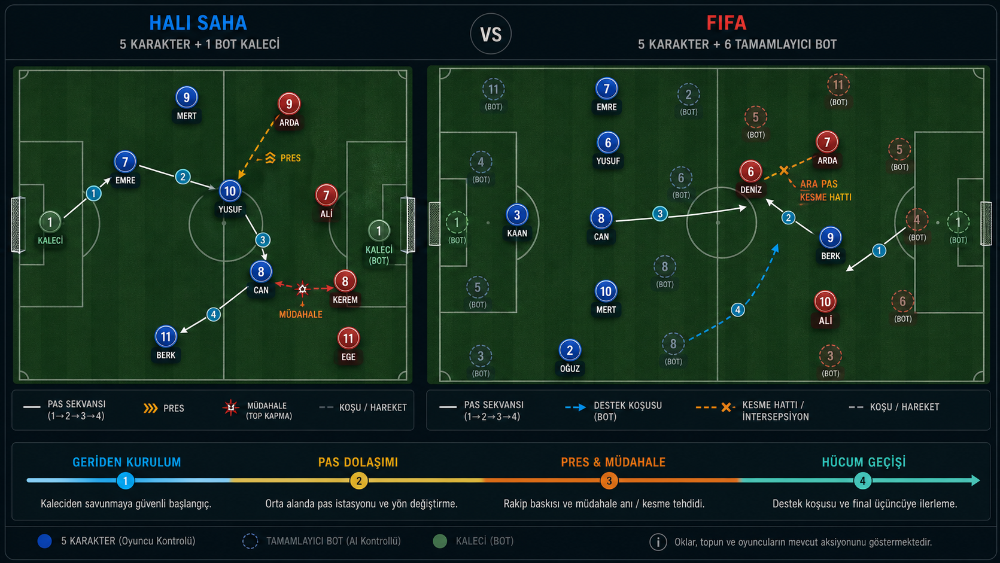

# 5X5 — Simülasyon Savaşları

[](https://github.com/EddizEge/5x5/releases/latest)
[](https://nodejs.org/)
[](https://docs.docker.com/compose/)

Kartlarını seç, takımını kur, taktiğini belirle ve beş farklı branşta canlı simülasyonları izle.

[Proje sayfasını aç](https://eddizege.github.io/5x5/) · [Son sürümü indir](https://github.com/EddizEge/5x5/releases/latest)



5X5; League of Legends, Valorant, Counter-Strike, Halı Saha ve FIFA branşlarını aynı çok oyunculu turnuva deneyiminde birleştiren tarayıcı tabanlı bir simülasyon oyunudur. Draft, taktik, rol dağılımı, canlı anlatım, görsel maç motorları ve turnuva puanlaması tek uygulamada çalışır.

## Neler var?

| Deneyim | İçerik |
| --- | --- |
| Çok oyunculu | Socket.IO tabanlı lobi, hazır durumu ve kalıcı sohbet |
| Draft | Dönem kartları, branşa özel puanlar, roller ve oyun stilleri |
| Oyun modları | Basit, Taktiksel ve deneysel Beta lobileri |
| Futbol V2 | Halı Saha ve FIFA için konumsal tam maç, xG/xA ve canlı oyuncu notları |
| Counter-Strike Beta | Gerçek Dust II nav ağı, ekonomi, utility, ses, görüş ve dünya durumlu raundlar |
| Yönetim | Karakter, dönem, puan ve taktik değişimlerini yöneten admin paneli |

## Hızlı kurulum — Docker

Gereksinimler: Docker ve Docker Compose.

```bash
git clone https://github.com/EddizEge/5x5.git
cd 5x5
docker compose up -d --build
```

Ardından [http://localhost:3000](http://localhost:3000) adresini açın.

İlk çalıştırmada uygulama yeni `data/5x5.db` dosyasını otomatik oluşturur. Veritabanında yalnızca ilk yönetici hesabı bulunur; kullanıcı, karakter, sohbet ve maç verileri boş başlar.

Varsayılan yerel yönetici hesabı:

- Kullanıcı adı: `admin`
- Şifre: `5x5admin`

Admin panelinden kendi karakterlerinizi ve dönem kartlarınızı ekleyebilirsiniz. İnternete açık bir kurulumdan önce `.env.example` dosyasını `.env` adıyla kopyalayın ve en azından `ADMIN_PASSWORD` değerini değiştirin. `JWT_SECRET` boş bırakılırsa uygulama `data/.jwt-secret` içinde kuruluma özel güvenli bir anahtar üretir.

Genel demo karakterleriyle başlamak isterseniz `.env` içinde `SEED_DEMO_DATA=true` kullanabilirsiniz. Varsayılan değer `false` olduğu için temiz kurulum her zaman boş başlar.

## Node.js ile çalıştırma

Gereksinim: Node.js 20 veya üzeri.

```bash
npm install
copy .env.example .env
npm start
```

Windows dışındaki sistemlerde ikinci komut yerine `cp .env.example .env` kullanabilirsiniz.

## Testler

Ana regresyon paketleri:

```bash
npm run test:football-decisions
npm run test:football-v2-world
npm run test:football-v2-rollout
npm run test:cs-beta-release
```

Diğer hedefli testler `package.json` içindeki `test:*` komutlarında listelenir.

## Mimari

- Backend: Node.js, Express, Socket.IO
- Veritabanı: SQLite (`better-sqlite3`, WAL, foreign keys)
- Frontend: Vanilla JavaScript, HTML ve CSS
- Dağıtım: Docker / Docker Compose

Uygulama kaynakları `server/`, `public/` ve `scripts/` klasörlerinde bulunur. Ayrıntılı simülasyon mimarisi ve proje kuralları `AGENTS.md` içinde belgelenmiştir.

## Veri güvenliği

Gerçek çalışma veritabanı, `.env`, JWT anahtarı, kullanıcı verileri, loglar ve yerel test çıktıları depoya dahil edilmez. `data/` klasörü yalnızca boş bir yer tutucu taşır; her kurulum kendi veritabanını üretir.

## Sürüm

İlk genel sürüm: [`v1.0.0`](https://github.com/EddizEge/5x5/releases/tag/v1.0.0). Değişiklik geçmişi için [CHANGELOG.md](CHANGELOG.md) dosyasına bakın.
